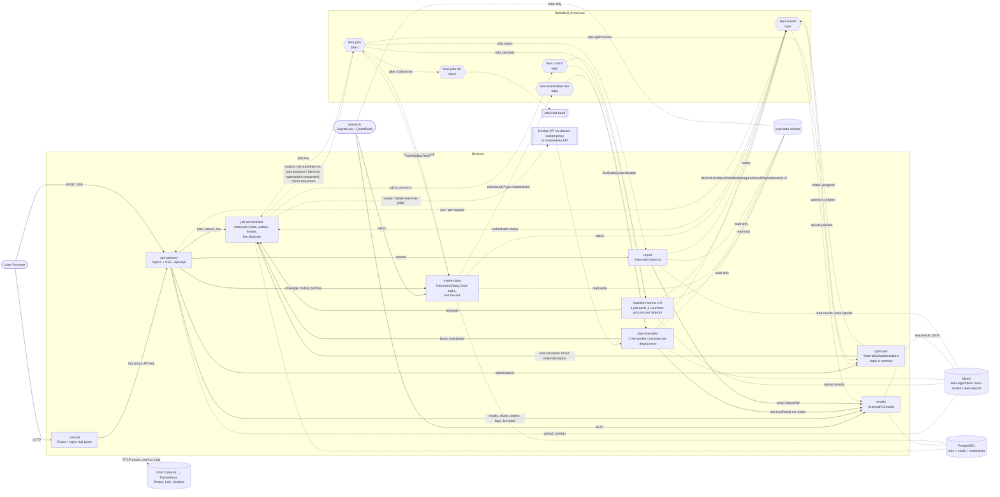

# Context diagram (contract v1, as built)

Services and their contracts as merged on `master` (ADR 0006 lists where this differs from ADRs 0001–0005). Solid
arrows: HTTP (OpenAPI under `../openapi/`); dashed: RabbitMQ (exchange, routing key, schema under `../messages/v1/`);
dotted: storage (ADR 0003/0004) and container control.

Not drawn: every service's `/healthz` and `/readyz`; the toolbox one-shot jobs, which write `lean-data` through a
staging copy like market-data.
