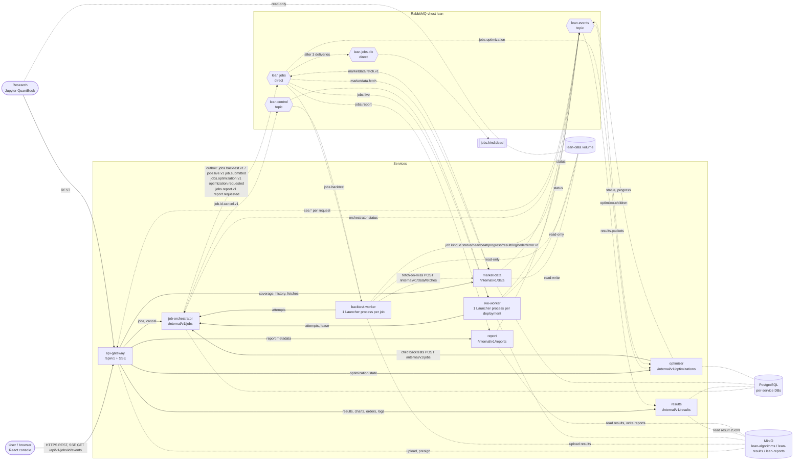

# Context diagram (contract v1)

Services and their contracts. Solid arrows: HTTP (OpenAPI under `../openapi/`); dashed: RabbitMQ (exchange,
routing key, schema under `../messages/v1/`); dotted: storage (ADR 0003/0004).

