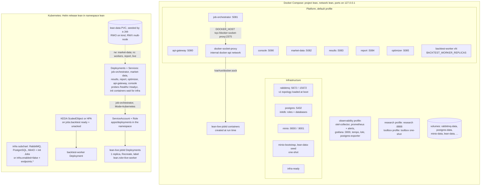

# Deployment diagram (as built)

The same images run on Docker Compose (`docker-compose.yml`, `make up`) and on Kubernetes (Helm chart
`deploy/helm/lean-platform`). Images: `lean/<service>:dev` built locally (`Services/Dockerfile`, `docker buildx bake -f
Services/docker-bake.hcl`) or `ghcr.io/jricetti-cog/lean/<service>:<tag>`.

