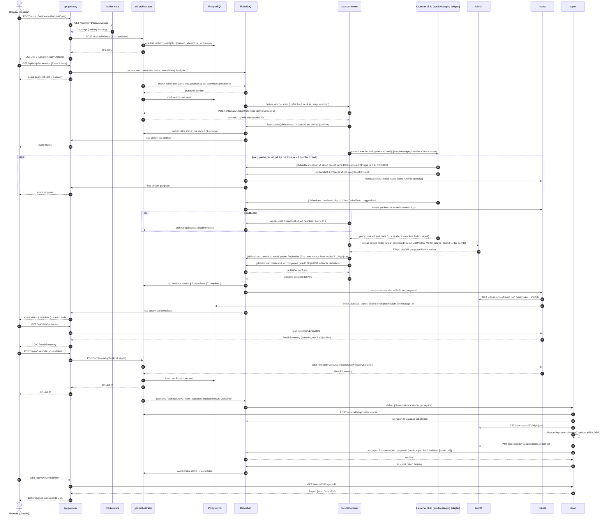

# Sequence: submit backtest → worker → results → report (contract v1)

Happy path with the acknowledgement points of ADR 0002 and the MinIO references of ADR 0005. `J` is the
backtest job id, `R` the report job id. Message bodies: `../messages/v1/`; examples with the same ids:
`../messages/v1/examples/`.

Failure paths (not drawn): a worker crash before the ack redelivers the dispatch; the next worker calls
`POST /internal/v1/jobs/J/attempts` with `deliveryCount ≥ 1` and writes to `lean-results/J/2/`. After 3
deliveries the message dead-letters to `jobs.backtest.dead` and the orchestrator publishes `job.failed`
(`final: true`). Cancel: `POST /api/v1/jobs/J/cancel` → orchestrator → `lean.control` `job.J.cancel.v1` →
worker stops the child, uploads what exists, publishes `job.cancelled`, acks.
